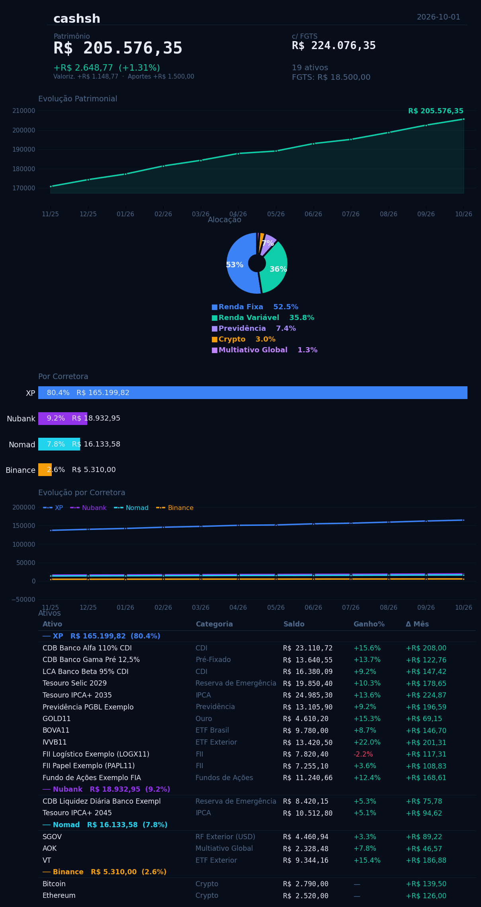

# investsh

Controle pessoal de investimentos no terminal, feito para o investidor
brasileiro. **100% local**, em Python puro: sem servidor, sem conta, sem dependências
obrigatórias. Seus dados ficam em arquivos JSON no seu computador.

- **Carteira** — patrimônio total, alocação atual vs. ideal, reserva de emergência, exposição
  por indexador e por objetivo, visão por corretora e gráficos de evolução no terminal
- **Rentabilidade vs CDI e IPCA** — quanto a carteira rendeu descontando os aportes, por mês,
  nos últimos 12 meses e desde o início, lado a lado com o CDI e o IPCA do mesmo período
  (dados do Banco Central)
- **Alertas de vencimento** — títulos que vencem nos próximos 90 dias (ou já venceram) aparecem
  no Sumário, com aviso ao abrir quando faltam 30 dias ou menos
- **Rotina mensal** — atualize saldos, registre aportes e saques, cadastre ativos; cada save
  guarda um snapshot no histórico
- **Cotações automáticas** — dólar ([AwesomeAPI](https://docs.awesomeapi.com.br/)) e cripto
  ([CoinGecko](https://www.coingecko.com/en/api)) recalculam esses ativos ao abrir
- **Resumo em imagem** — com `matplotlib`, gera um PNG da carteira a cada save
- **Análise com IA** — gera um prompt completo da carteira para colar no Claude ou outro assistente



---

## Começo rápido

Requisito: **Python 3.9+** (macOS ou Linux; no Windows, use o WSL). Instale com
[pipx](https://pipx.pypa.io), que coloca o comando `investsh` no seu PATH:

```bash
pipx install git+https://github.com/henriqueboaventura/investsh.git
```

Para atualizar depois para a [última versão](https://github.com/henriqueboaventura/investsh/releases):

```bash
pipx upgrade investsh
```

Depois é só rodar, de qualquer pasta:

```bash
investsh
```

Seus dados ficam em **`~/.investsh/`**. Para usar outra pasta:

| Como | Exemplo |
|---|---|
| Opção `--dir` | `investsh --dir ~/minhas-financas` (ou `--dir .` para a pasta atual) |
| Variável de ambiente | `export INVESTSH_DIR=~/minhas-financas` |
| Link simbólico | `ln -s ~/minhas-financas ~/.investsh` (útil se a pasta é um repositório git em outro lugar) |

Na primeira execução o investsh cria `~/.investsh/data/investments.json` e pergunta:

- **Carteira vazia** (recomendado) — para começar a cadastrar seus ativos
- **Dados de exemplo** — uma carteira fictícia, para explorar antes de usar de verdade

Depois:

1. Tecle `p` (**Parâmetros**) e ajuste FGTS, aporte mensal, premissas de projeção,
   alocação ideal e faixa da reserva de emergência.
2. Tecle `n` (**Novo ativo**) para cadastrar cada investimento.
3. Tecle `w` para salvar.

> Prefere editar JSON à mão? Use [`src/investsh/examples/investments.json`](src/investsh/examples/investments.json)
> como modelo em `data/investments.json`.
> O formato está em [docs/DATA_FORMAT.md](docs/DATA_FORMAT.md).

Opcional — para o resumo em imagem, instale o matplotlib junto:

```bash
pipx inject investsh matplotlib
```

---

## Rotina mensal

```bash
investsh
```

| Tecla | Ação |
|---|---|
| `u` | Atualizar o saldo de todos os ativos, um a um (Enter mantém o valor) |
| `Enter` | Na aba Detalhe: atualizar saldo, aporte, saque, provento, transferir, liquidar vencimento, editar dados ou excluir o ativo selecionado. Na aba Lançamentos: corrigir o lançamento selecionado |
| `n` | Cadastrar novo ativo |
| `p` | Parâmetros |
| `/` | Buscar (aba Detalhe) |
| `s` `r` `a` `i` `o` `d` `l` `b` `g` | Abas: Sumário, Rentabilidade, Alocação, Indexador, Objetivo, Detalhe, Lançamentos, Brokers, Gráficos |
| `↑` `↓` / `j` `k` | Navegar |
| `R` | Recarregar do disco (após editar os arquivos por fora) |
| `w` | Salvar |
| `q` | Sair |

**Saldo estimado.** Para renda fixa em reais com taxa cadastrada (`rate` em % do CDI ou
prefixada), a atualização de saldo mostra o **estimado hoje**: o último saldo registrado
rendendo a taxa desde a data em que foi registrado (CDI diário do Banco Central; prefixado
em dias úteis). Se o valor digitado diferir mais de 1% do estimado, a barra avisa: costuma
ser erro de digitação ou de ativo. A estimativa é bruta (sem IR) e deixa de fora Tesouro
Direto (preço de mercado), IPCA+ e ativos em dólar. Cadastre a taxa em *Editar dados*.

**Valor líquido de IR.** O Sumário mostra, para a renda fixa em reais, quanto você
resgataria hoje: bruto, IR + IOF e líquido. O IR segue a tabela regressiva sobre o ganho
(22,5% até 180 dias, 20% até 360, 17,5% até 720, 15% acima), e o IOF vale nos primeiros
29 dias. LCA, LCI e ativos com `taxExempt` são isentos. A coluna **Líquida** é a taxa
descontado o IR do prazo até o vencimento: compare CDB com LCA por ela (CDB 116% do CDI por
mais de 2 anos ≈ 98,6% do CDI líquido). Sem `purchaseDate`, o prazo conta da primeira foto
do histórico e o IR aparece com `≈` (pode ficar acima do real): cadastre a data da compra
em *Editar dados*. Fundos, ETFs e ações ficam de fora (regras próprias).

Ao salvar:

- `data/investments.json` é gravado e um snapshot vai para `data/history.json`
  (alimenta os gráficos de evolução);
- com `matplotlib` instalado, o resumo visual é gerado em `assets/status.png`;
- com o [commit automático](#versionar-seus-dados-com-git) ligado, os dados são commitados
  e enviados ao remoto.

Na tela interativa, a imagem e o commit/push rodam **em segundo plano**: a tela não trava
e você pode sair na hora, que o envio continua sozinho. A barra mostra `↻ enviando…` e
depois o resultado (`↑ push ok` ou `⚠ push falhou`). Se um envio falhar (ex.: sem
internet), o investsh avisa na próxima vez que abrir; para reenviar:

```bash
investsh sync     # gera a imagem e faz commit/push agora, mostrando o resultado
```

Para scripts e terminais sem tela interativa: `investsh check` (conferir os dados),
`investsh sync` (imagem e commit/push) e `investsh analyze` (prompt para IA). O modo texto
`--menu` foi removido na 1.0.0.

### Conferir os dados

```bash
investsh check    # procura inconsistências; não altera nada
```

Aponta **erros** (dados que quebram cálculos: nome + corretora repetidos, saldo negativo,
data inválida, provento positivo) e **avisos** (título vencido com saldo, saldo que variou
mais de 20% desde o save anterior sem aporte nem saque, renda fixa sem taxa ou vencimento,
lançamento de um ativo que nunca existiu, nome da reserva que não está na carteira, ativo
zerado, saldo sem atualização há mais de `stale_days` dias). A tela interativa avisa ao abrir,
lista os ativos em **Saldos desatualizados** no Sumário e mostra, em *Atualizar todos*, a
data em que cada saldo foi registrado. Sai com código 1 se houver erro. A tela interativa avisa ao abrir quando há erros.

---

## Análise com IA

```bash
investsh analyze
```

Gera um prompt com toda a carteira (alocação vs. ideal, desempenho, vencimentos, parâmetros)
e copia para o clipboard (macOS). Sem clipboard, salva em `analise_prompt.txt`. Cole numa
conversa nova no [claude.ai](https://claude.ai) ou no assistente que preferir. Lembre que
isso envia os dados da sua carteira para o serviço escolhido.

---

## Rentabilidade

A aba **Rentabilidade** (tecla `r`) responde: *a carteira rendeu mais
que o CDI?* Para isso o investsh usa as fotos que cada save grava em `data/history.json`:

- entre dois saves, o rendimento desconta o dinheiro que entrou e saiu da carteira no
  período (método de Dietz modificado: aportes contam pela metade do período);
- CDI e IPCA vêm da API pública do Banco Central, acumulados exatamente no mesmo período,
  e ficam em cache por 12 horas em `~/.cache/investsh` (sem internet, usa o cache). A
  busca roda em segundo plano: a tela não trava se o Banco Central demorar;
- o IPCA de um mês só sai no mês seguinte: meses ainda não divulgados aparecem com `*`.

Salvar uma vez por mês já basta para a visão mensal. No **Sumário**, o *Histórico mensal*
decompõe a variação do saldo de cada mês: **Variação = Aportes + Saques + Valorização**, com
a rentabilidade do mês ao lado.

### O que conta como aporte e saque

O investsh registra cada entrada e saída de dinheiro (em `flows`, no `investments.json`):

| Ação | Conta como |
|---|---|
| **Registrar aporte** / **Registrar saque** | aporte / saque, pelo valor em dinheiro |
| **Registrar provento** (dividendo, cupom pago na conta) | provento: saiu da carteira, mas é rendimento; o saldo não muda |
| **Transferir para outro ativo** (resgate reinvestido, caixa → título) | nada: o dinheiro só muda de ativo. Se entrou mais do que saiu, pergunta se a diferença é aporte; se saiu mais, se foi saque ou custo/IR |
| **Liquidar vencimento** (título com vencimento) | o valor líquido creditado substitui o saldo (rendimento e IR ficam na valorização); depois, até o saldo acabar: reinvestir (*Transferir*), deixar no **Caixa <corretora>** (criado se preciso, grupo `CAIXA_TRANSITORIA`) ou sacado (saque). O título zerado sai da carteira |
| **Novo ativo** com saldo | pergunta: dinheiro novo (aporte) ou veio de outro ativo |
| **Excluir ativo** com saldo | pergunta: foi sacado (saque) ou foi para outro ativo |
| **Atualizar saldo** (inclusive quantidade de cripto) | valorização |
| **Editar dados do ativo** (nome, corretora, taxa, vencimento, liquidez...) | nada: o saldo não muda. Trocar nome ou corretora leva junto os lançamentos do ativo e a lista `assetNames` da reserva; as fotos do histórico ficam com o nome antigo |

Provento que você reinveste (no mesmo ativo ou em outro) é um *Registrar aporte* normal,
depois do *Registrar provento*. Quando há proventos, o *Histórico mensal* ganha a coluna
**Proventos**.

Ou seja: depósitos e resgates de verdade passam por *Registrar aporte/saque*; dinheiro que
muda de ativo passa por *Transferir* (não use *Registrar saque* na origem: isso conta como
dinheiro saindo da carteira). A transferência baixa o saldo e o custo da origem na mesma
proporção, sobe os do destino e, se a origem zerar, oferece excluí-la. Cripto fica de fora
(o saldo vem da quantidade): compra de cripto com dinheiro novo aparece como valorização,
então registre um aporte em outro ativo antes de transferir.

A aba **Lançamentos** (`l`) lista tudo isso por mês, do mais recente, com os totais de
aportes, saques e proventos (lançamentos anteriores a `flowsSince` aparecem apagados: não
entram na rentabilidade). Enter num lançamento corrige valor, data, tipo ou ativo, ou o
exclui. A correção é só do registro: os saldos dos ativos não mudam.

Antes do primeiro save com essa versão (`flowsSince`), sem os lançamentos, o investsh usa a
variação do custo total entre as fotos, que é uma aproximação.

## Privacidade

- O investsh só lê e escreve arquivos locais. As únicas chamadas de rede são as cotações
  (AwesomeAPI e CoinGecko), que não recebem nenhum dado seu.
- Seus dados ficam em `~/.investsh/` (ou na pasta que você escolher), separados do código.
  Nada vai para o git a menos que você ligue o commit automático (abaixo).

### Versionar seus dados com git

Para ter histórico ou sincronizar entre computadores, faça da sua pasta de dados um
repositório git **privado** e crie nela um arquivo `investsh.toml`. Se o repositório já
existe em outro lugar, aponte o `~/.investsh` para ele com um link simbólico:

```bash
git clone git@github.com:voce/minhas-financas.git ~/minhas-financas   # privado!
ln -s ~/minhas-financas ~/.investsh
```

`~/.investsh/investsh.toml`:

```toml
[git]
auto_commit = true   # commit "update AAAA-MM" a cada save
push = true          # e envia para o remoto (false = só commit local)
```

A configuração vale só para essa pasta de dados: usar outra com `--dir` não commita nada.
Commits que não chegarem ao remoto (ex.: sem internet) são avisados ao abrir o investsh e
reenviados no próximo save ou com `investsh sync`.
Sem o arquivo (ou com `auto_commit = false`), o commit automático fica desligado.
Para ligar ou desligar temporariamente, por cima do arquivo: `FINANCES_AUTO_GIT=1` ou `0`.

O mesmo arquivo ajusta a janela dos alertas de vencimento (padrão: 90 dias) e de saldo
desatualizado (padrão: 30 dias sem atualizar o saldo do ativo):

```toml
[alerts]
maturity_days = 180
stale_days = 45
```

---

## Personalização

| O quê | Onde |
|---|---|
| Alocação ideal, reserva, FGTS, projeção | Tecla `p` no `investsh`, ou `data/investments.json` |
| Commit automático dos dados | `investsh.toml` na pasta de dados (ver [Privacidade](#versionar-seus-dados-com-git)) |
| Grupos de alocação | `GROUP_META` em `src/investsh/core.py` |
| Corretoras e ordem | `_BROKERS` e `BROKER_ORDER` em `src/investsh/core.py`; cores em `BR_C` (`image.py`) |
| Criptos com cotação automática | `CRYPTO_IDS` (IDs do CoinGecko) em `src/investsh/core.py` |

Ativos com `investedUSD` (ex.: corretora Nomad) são tratados como investimentos em dólar e
convertidos pela cotação do dia.

---

## Estrutura

```
├── src/investsh/
│   ├── cli.py            # Comando `investsh` (--dir, analyze, check, sync)
│   ├── app.py            # Carrega a carteira e abre a TUI
│   ├── core.py           # Regras: classificação, custo base, reserva, histórico, R$
│   ├── perf.py           # Rentabilidade descontando aportes vs CDI/IPCA
│   ├── bench.py          # CDI e IPCA do Banco Central (com cache)
│   ├── quotes.py         # Cotações (dólar e cripto)
│   ├── tui.py            # Tela interativa (curses)
│   ├── image.py          # Imagem de resumo (matplotlib)
│   ├── storage.py        # Primeira execução, salvar, histórico
│   ├── sync.py           # Imagem + commit/push (em segundo plano na TUI; `investsh sync`)
│   ├── analyze.py        # Prompt de análise para IA
│   ├── check.py          # `investsh check`: inconsistências nos dados
│   ├── estimate.py       # Saldo estimado da renda fixa (% do CDI, prefixado)
│   ├── tax.py            # IR/IOF da renda fixa: resgate líquido e taxa líquida
│   └── examples/         # Dados fictícios (ponto de partida)
├── tests/                # Testes de regressão (ver tests/README.md)
└── docs/
    └── DATA_FORMAT.md    # Formato dos arquivos JSON
```

Na pasta de dados (`~/.investsh`, ou a escolhida com `--dir` / `$INVESTSH_DIR`):

```
├── investsh.toml         # opcional: configuração (commit automático)
├── data/
│   ├── investments.json  # carteira atual
│   └── history.json      # snapshots a cada save
└── assets/status.png     # resumo em imagem (com matplotlib)
```

---

## Problemas comuns

**Caracteres estranhos, sem cores ou tela cortada** — use um terminal UTF‑8 com pelo menos
100 colunas.

**`_curses` não encontrado (Windows)** — rode no WSL.

**Cotações não atualizam** — as APIs públicas têm limite de requisições; espere um minuto e
abra de novo. Sem cotação, os saldos salvos continuam valendo.

**"pip install matplotlib → necessário para imagem"** — aviso apenas; tudo funciona sem ele,
só não gera o PNG.

---

## Contribuindo

O projeto tem uma suíte de regressão que cobre a TUI, a imagem, os comandos e os cálculos:

```bash
git clone https://github.com/henriqueboaventura/investsh.git && cd investsh
python3 -m venv .venv && .venv/bin/pip install -e '.[dev]'
.venv/bin/pytest          # rápidos (~10s)
.venv/bin/pytest --all    # inclui a tela interativa (~1 min); é o que o CI roda
```

Detalhes em [tests/README.md](tests/README.md).

### Versões e releases

O investsh segue o [versionamento semântico](https://semver.org/lang/pt-BR/). A versão fica
em `__version__`, no [`src/investsh/__init__.py`](src/investsh/__init__.py), e sobe no mesmo
commit da mudança:

| Mudança | Versão | Exemplo |
|---|---|---|
| Correção de bug | patch (`0.2.0` → `0.2.1`) | save que gravava o saldo anterior errado |
| Funcionalidade ou mudança compatível | minor (`0.2.1` → `0.3.0`) | nova ação na TUI, novo campo opcional |
| Mudança incompatível | major (`0.3.0` → `1.0.0`) | formato de dados que os arquivos antigos não carregam, opção removida |

Cada versão publicada ganha uma tag `vX.Y.Z` e uma
[release no GitHub](https://github.com/henriqueboaventura/investsh/releases) com o que mudou:

```bash
git tag -a v0.2.1 -m v0.2.1 && git push origin v0.2.1
gh release create v0.2.1 --verify-tag --title v0.2.1 --notes "..."
```

Sem a mudança de versão, o `pipx upgrade investsh` não instala os commits novos.

## Aviso

Ferramenta pessoal de organização, não recomendação de investimento. Confira sempre os saldos
nos extratos oficiais.

## Licença

[MIT](LICENSE)
